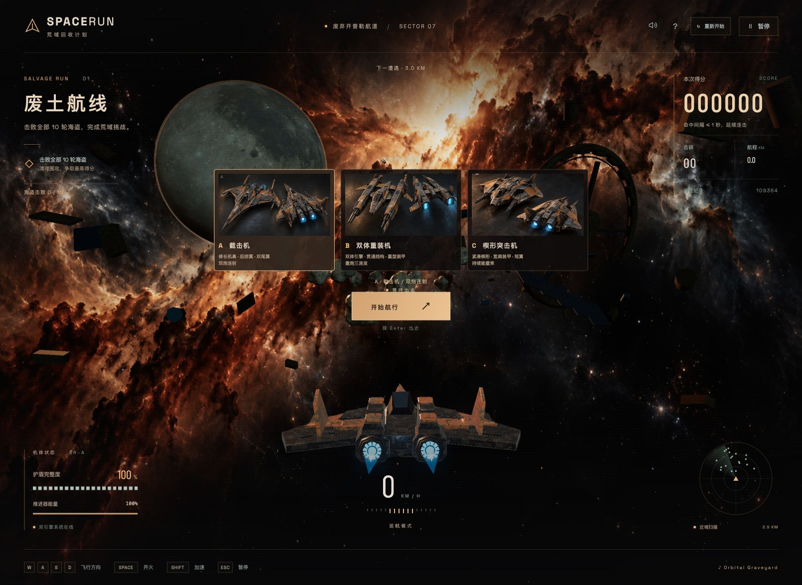

# SPACERUN

A 3D space-wasteland shooter built with Three.js and Vite. Choose a weathered salvage fighter, fly through asteroid fields, survive overlapping pirate attacks, and defeat all ten pirate waves for the highest score.



The current version runs in a desktop browser with keyboard and mouse controls. Tablet touch controls and native desktop/mobile apps are planned; they are not included in this version.

## Fighters

| Fighter | Shape | Weapon |
| --- | --- | --- |
| A · Interceptor | Swept wings, long nose, twin tails | Paired energy bolts every 150 ms |
| B · Heavy fighter | Twin booms and layered armor | Three paired cannon rounds, 85 ms apart, then a 480 ms gap |
| C · Assault fighter | Compact wedge and broad shoulders | Twin continuous beams, applying damage every 100 ms |

All three share movement, shield, and boost parameters. A quick heavy-cannon tap completes one burst. Beams stop at the nearest solid target and burn asteroids over several ticks. The procedural ships use chipped armor, exposed connectors, ribbed engines, and dedicated steel and ochre textures inspired by the included concept art.

## Run

Requires Node.js 20.19+ or 22.12+ and a browser with WebGL 2 and hardware acceleration.

```sh
git clone https://github.com/nervouna/spacerun.git
cd spacerun
npm ci
npm run dev
```

Open the local URL printed by Vite, choose a fighter, then select **开始航行** or press Enter. Selecting a card updates the 3D preview. Launch opens with a short camera approach and route title; peripheral light streaks accompany launch and boost. Flight controls remain active during departure. Use **重新开始** in the top bar, pause menu, or end menu to return to fighter selection. Abandoning an unfinished run clears its score without updating the best record. After a settled run, **再次出击** starts directly with the current selection. Click the game to focus it before using the keyboard.

| Key | Action |
| --- | --- |
| W / A / S / D | Move up / left / down / right |
| Space (hold) | Fire continuously |
| Shift (hold) | Boost while energy remains |
| Escape | Pause or resume |
| Enter | Start, resume, or restart |
| Mouse wheel | Zoom the camera in or out |
| Left mouse button + drag | Look around; release to smoothly recenter |

## Mission and scoring

Defeat all ten pirates to complete the run and settle your final score. Distance alone does not end the mission; pirates from earlier rounds must also be cleared. Shield depletion ends the run early. Asteroid kills award `137 + round(radius × 13)` points, and each confirmed pirate hit awards 17 points for interceptor bolts, 26 for heavy rounds, or 11 per beam damage tick. Nonlethal asteroid beam ticks award 7 points. Hits no more than one second apart extend a combo: each subsequent hit multiplies its base reward by `1.12^(combo - 1)`, capped at 32×, with each award rounded to an integer. Missing for over one second ends the combo. Damage deducts `137 + shield damage × 11` points (down to a minimum score of zero) and breaks the combo. Pausing freezes the combo clock. Pirate defeat bounties remain separate from the combo multiplier.

## Pirate encounters

Pirates enter at every 3 km milestone from 3 through 30 km, after an advance warning. New pirates join even while earlier ones remain alive. Each sweeps in from the side and rear, drifts through a half-turn, and charges its red gun ports before firing toward a locked player position. The first two pirates retain their repeating drift. From stage 3 (9 km), each new pirate follows independent random waypoints with smooth changes of velocity. Stage 5 (15 km) raises the movement speed limit from 8 to 12 units/s, then to 14.4 by stage 8. From stage 8 (24 km), volleys gain upper and lower rows: seven horizontally spread shots per row, 21 in total. Charging still warns before each volley and locks its target in advance. Armor, bullet speed, and firing frequency also increase, with difficulty capped at stage 8. The encounter display shows the active ship count and one target's armor; the radar tracks all active pirates. Defeating a pirate awards 1,000 points multiplied by its stage and restores 20% shield (up to 100%). The tenth pirate is the final reinforcement. The finish screen appears once all ten are defeated and includes final score, distance, pirate defeats, asteroid kills, and maximum combo.

## Feedback and audio

Collisions remove 25% shield and grant a brief recovery period. Boost energy regenerates when not boosting; after exhaustion, release Shift before boosting again. Hits produce armor flashes and sparks or a player shield ripple, damage direction, shield-loss and score-penalty readout, and camera shake. Ship explosions scatter metal plates; asteroids scatter rock fragments. Asteroid density drops during encounters. The game pauses when the browser loses focus.

Sound is enabled by default. The first click or key press unlocks browser audio. The speaker button mutes or unmutes both music and effects. Fighter selection loops Orbital Graveyard; combat randomly rotates Hard Battle 2, Trance Battle, and Space Battle without consecutive repeats. All three combat tracks play at 140 BPM, with Space Battle adjusted offline from 130 BPM without shifting pitch. Music fades between selection and combat and pauses in menus or when the tab is hidden, resuming at the same position. The beam loops the selected softened electrical sample; explosions use a locally bundled recording of a real blast, with type, distance, and size affecting playback. Pausing, returning to the hangar, or muting stops active sample playback. Other weapon and interface sounds remain synthesized.

## Saved scores and assets

The best score for the current scoring rules is saved in this browser's local storage, separately from the previous scoring system. Clear site data to remove it. No account or backend is used. The wasteland scene combines a generated nebula backdrop, locally bundled 2K rock and rusty-metal PBR textures, a NASA lunar surface map, and procedural ships, station wreckage, debris, and stars. See [asset sources](ASSETS.md) for provenance. The interface optionally loads fonts from Google Fonts, with local fallbacks.

## Development

Built with Three.js and Vite. `src/main.js` contains rendering and gameplay, `src/physics.js` contains collision and energy calculations, `src/wasteland.js` contains surface details and wreckage, and `src/style.css` contains the interface.

```sh
npm test
npm run build
npm run preview
```

Build output goes to `dist/`. Preview serves that build locally; it does not publish the game.


## License

Original project code and original project assets are released under the [MIT License](LICENSE). Third-party assets retain their own licenses and usage terms: CC0 music, textures, and explosion audio, plus NASA imagery. Credits and source links are in [ASSETS.md](ASSETS.md). Third-party dependencies retain their respective licenses.

Runtime assets are included in `public/assets/`. Local generation outputs, auditions, downloaded originals, dependencies, and build output are excluded from Git; none is required to run the game after `npm ci`.
